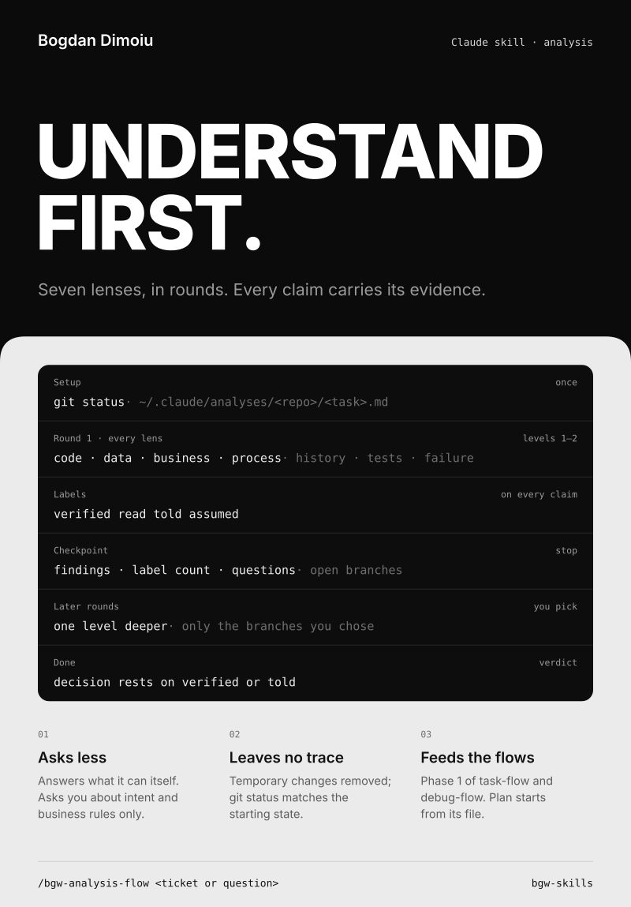
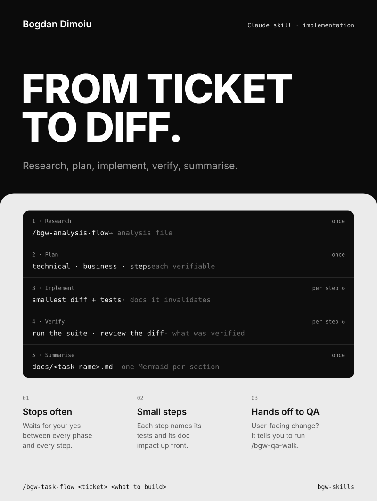
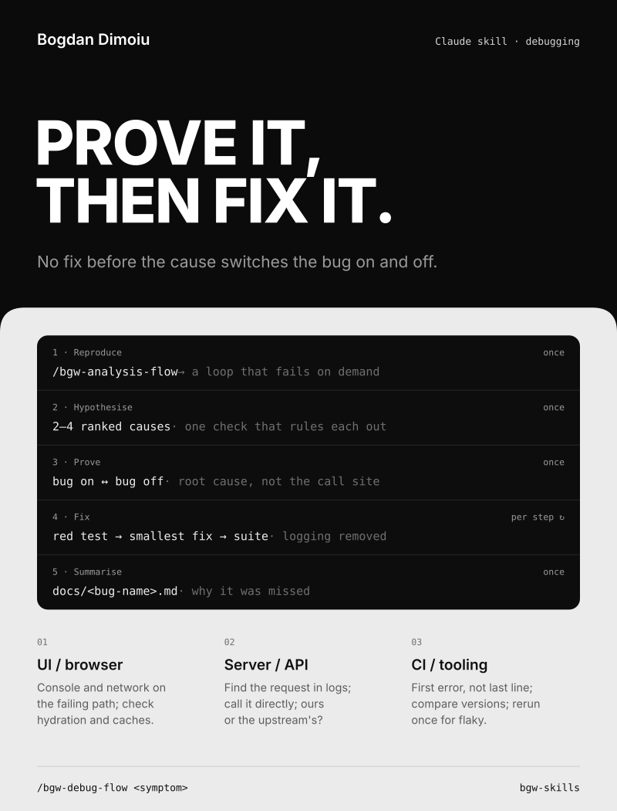
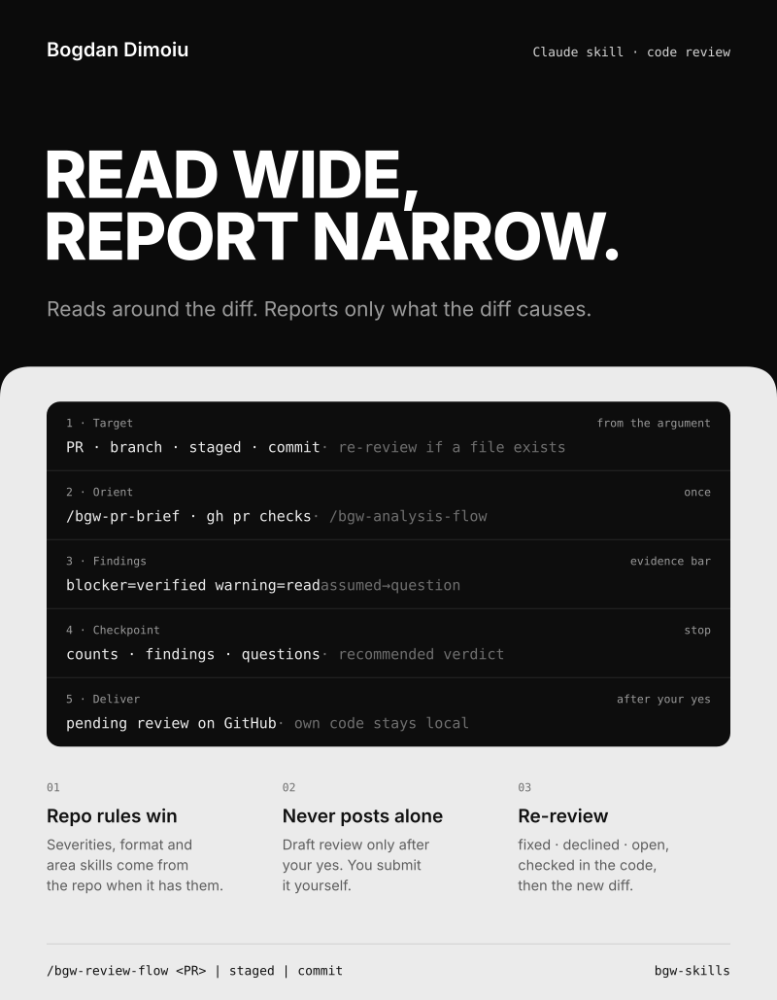
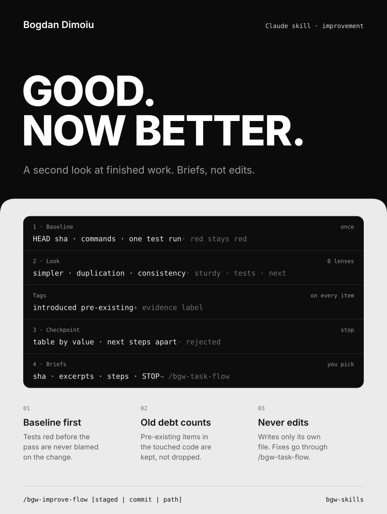
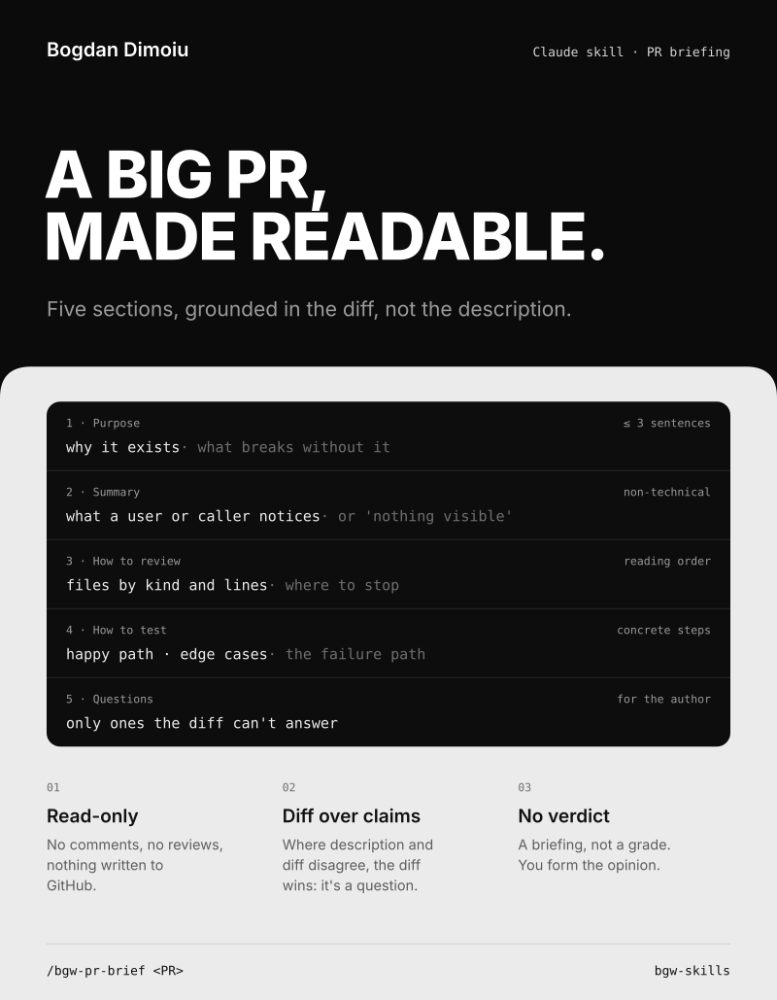
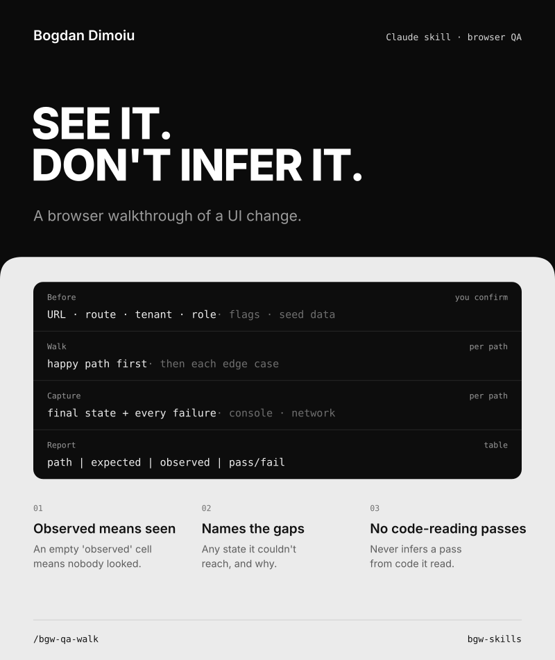
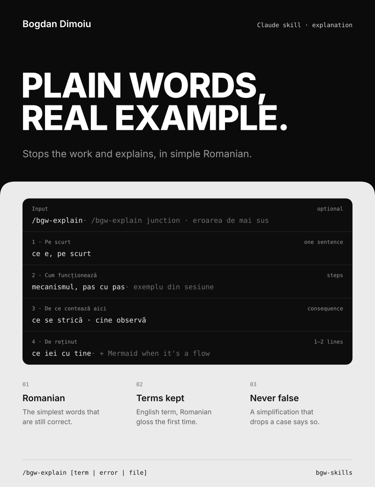
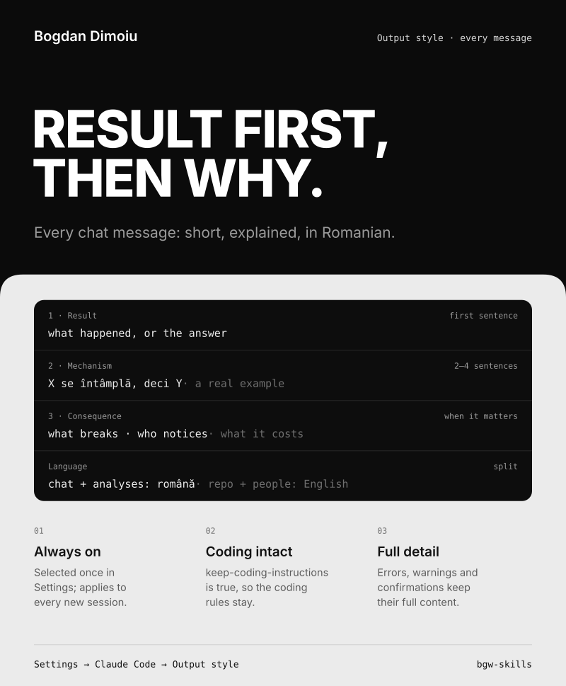

# bgw-skills

Personal Claude Code skills and the global working agreement. Every skill works in
any repository. Where a repository has its own rules (review format, severities,
test conventions), those rules win and the skill adds only its process.

## Skills

| Skill | Use it when | Start it with |
| --- | --- | --- |
| `bgw-analysis-flow` | You only want to understand something: a ticket, a flow, a process, a PR | `/bgw-analysis-flow <ticket or question>` |
| `bgw-task-flow` | You implement a feature or fix that spans more than one file | `/bgw-task-flow <ticket> <what to build>` |
| `bgw-debug-flow` | Something is broken and the cause is unknown | `/bgw-debug-flow <symptom>` |
| `bgw-review-flow` | You review a PR, or your own changes before opening one | `/bgw-review-flow <PR>`, `/bgw-review-flow`, `/bgw-review-flow staged` |
| `bgw-improve-flow` | Something is built and working, and you want a second look at what could be better | `/bgw-improve-flow`, `/bgw-improve-flow <path>` |
| `bgw-pr-brief` | You want to understand a PR before reading it | `/bgw-pr-brief <PR>` |
| `bgw-qa-walk` | You want to see a UI change working in the browser | `/bgw-qa-walk` |
| `bgw-explain` | You want something explained fully, in simple Romanian | `/bgw-explain`, `/bgw-explain <term, error, file>` |

A typical ticket: `bgw-task-flow` (it runs `bgw-analysis-flow` as phase 1), then
`bgw-qa-walk` if the change is user-facing, then `bgw-review-flow` on the branch
before opening the PR, and `bgw-review-flow` again after fixes. A bug starts with
`bgw-debug-flow` instead. Once the work is done and working, `bgw-improve-flow`
looks for what could be better and writes briefs for the next `bgw-task-flow`.

### bgw-analysis-flow



Understands a problem completely before anything is planned or changed. It works
in rounds and stops after each one.

- Round 1 covers seven lenses: code, data and contracts, business logic, processes,
  history, tests, failure modes. A lens that does not apply is marked "n/a" with a
  reason. Later rounds go one level deeper, only on the branches you pick.
- Every claim carries an evidence label: `verified` (ran something), `read` (read
  code or a sub-agent summary), `told` (from you or the ticket), `assumed` (a guess).
- It answers what it can by itself and asks you only about intent, business rules,
  priorities, and access, in one batch per round.
- It may run read-only commands and make temporary repo changes, which it removes
  and checks against the starting `git status`. Anything on staging, production,
  or an external system needs your yes.
- Output lives in `~/.claude/analyses/<repo>/<task>.md`, outside every repository.
- Complete when every claim the decision rests on is `verified` or `told`.

### bgw-task-flow



Research, plan, implement, verify, summarise. Stops for confirmation between every
phase and every step.

1. Research: runs `bgw-analysis-flow`.
2. Plan: technical and business view, then small steps that can each be verified.
3. Implement, per step: smallest diff, tests written with the change, docs updated.
4. Verify, per step: run the suite, review the diff, say what was and was not verified.
   Points you to `bgw-qa-walk` when the change is user-facing.
5. Summarise: `docs/<task-name>.md` with technical and business sections, one
   Mermaid diagram per section, and adjacent items you noticed but did not fix.

### bgw-debug-flow



Reproduce, hypothesise, prove the cause, fix with a regression test, summarise.
No fix before the cause is proven.

1. Reproduce: runs `bgw-analysis-flow`, then builds a loop that shows the bug on
   demand. Stops if it cannot reproduce, instead of guessing.
2. Hypothesise: two to four ranked causes, each with a check that rules it out.
   One change at a time.
3. Prove the cause: you can switch the bug on and off through it.
4. Fix, per step: the regression test first and failing for the right reason,
   then the smallest fix, then the suite. Temporary logging is removed.
5. Summarise: `docs/<bug-name>.md` with symptom, cause, fix, why it was missed,
   and a diagram of the failing path before and after.

Extra checklists for UI and browser bugs, server and API bugs, and CI and tooling bugs.

### bgw-review-flow



Reads around the diff, reports only on the diff. Works on someone else's PR or on
your own changes, and re-reviews after fixes.

1. Target: a PR link or number, the current branch against its nearest parent
   branch, `staged`, or `commit`. Code written in the same session is reviewed
   by a fresh sub-agent.
2. Orient and analyse: `bgw-pr-brief` for someone else's PR, CI status read with
   `gh pr checks` (red is a blocker), then `bgw-analysis-flow` with the diff as
   the problem.
3. Findings: eight criteria, with `ponytail:ponytail-review` for complexity. A
   finding counts only if the diff causes it. Evidence bar: a `blocker` needs
   `verified`, a `warning` needs `read` with the exact path, an `assumed` becomes
   a question for the author. Each finding comes with a suggested fix.
4. Checkpoint: severity counts, findings, questions, out-of-scope leads, and a
   recommended verdict. Then it stops.
5. Deliver: for someone else's PR, after your yes, a pending review that you
   submit yourself. For your own code, nothing leaves the machine and no file
   is changed.

Re-review starts from the earlier analysis file, checks each fix against the
committed code, then reviews only the new diff.

### bgw-improve-flow



A second look at finished work. Review asks "is this change correct?"; improve asks
"what would make it better?". It never edits code. The only file it writes is
`~/.claude/analyses/<repo>/<target>-improve.md`.

1. Target and baseline: the current branch, `staged`, `commit`, or a path, plus its
   direct callers. It records `HEAD`, the repo's commands, and one test run. Tests
   that were already red are the baseline: never a finding, never required to pass.
2. Look: eight lenses, with `ponytail:ponytail-review` for simpler code and
   `web-design-guidelines` when the scope renders UI. Each item is tagged
   `introduced` or `pre-existing`, carries an evidence label, and every cited line
   is re-read before you see it. Code written in the same session gets a fresh sub-agent.
3. Checkpoint: one table ordered by value for effort, next-step ideas apart,
   rejected items with a reason. Then it stops and you pick.
4. Briefs: one per picked item, for a session with no context: the starting SHA
   and a drift check, code excerpts, a file to copy the pattern from, scope, steps
   with commands and expected results, and STOP conditions. Hand a brief to
   `bgw-task-flow` to build it.

A second run checks each brief against `HEAD` (`done`, `stale`, `open`), then looks
only at what changed since.

### bgw-pr-brief



A read-only briefing that makes a large PR reviewable. No findings, no verdict,
nothing written to GitHub. Five sections, grounded in the diff rather than the PR
description: purpose, plain-language summary, how to review it (files split by
kind with line counts, then a reading order), how to test it, and questions for
the author.

### bgw-qa-walk



A browser walkthrough of a UI change. It confirms URL, route, tenant, role, flags,
and seed data with you first, then walks the happy path and each edge case. It
reports a table of path, expected, observed, and pass or fail, with screenshots
of final states and failures. It never infers a pass from reading code.

### bgw-explain



Stops the work and explains, in simple Romanian. With no argument it explains where
the session is now; with one it explains that thing in the session's context. Always
four parts: in short, how it works (as steps, with a real example from the session),
why it matters here, and what to remember. A small Mermaid diagram when the
explanation is a flow. Technical terms stay in English with a Romanian gloss.

## Output style: bgw-plain



[`output-styles/bgw-plain.md`](output-styles/bgw-plain.md) makes every chat message
Romanian, short, and explained: the result first, then the mechanism in two to four
plain sentences, then the consequence when it matters. Anything that reaches a
repository or other people stays in English. It keeps Claude Code's coding
instructions (`keep-coding-instructions: true`).

Select it in Settings → Claude Code → Output style. It applies to new sessions.

## Global working agreement

[`claude/CLAUDE.md`](claude/CLAUDE.md) is the global `~/.claude/CLAUDE.md`: process,
communication, implementation, tests, and honesty rules for every project.

## Install

```powershell
git clone https://github.com/bogdan-dimoiu/bgw-skills.git $HOME\Desktop\CODE\bgw-skills
& $HOME\Desktop\CODE\bgw-skills\install.ps1
```

The script links each skill folder into `~/.claude/skills`, and the `output-styles`
folder to `~/.claude/output-styles`, with Windows junctions, so editing a skill in the
repository changes it in Claude Code at once. It copies
`claude/CLAUDE.md` to `~/.claude/CLAUDE.md`. Anything it would replace is moved
to `~/.claude/bgw-backup-<timestamp>` first.

`CLAUDE.md` is a copy, not a link: edit it in the repository and run the script again.
